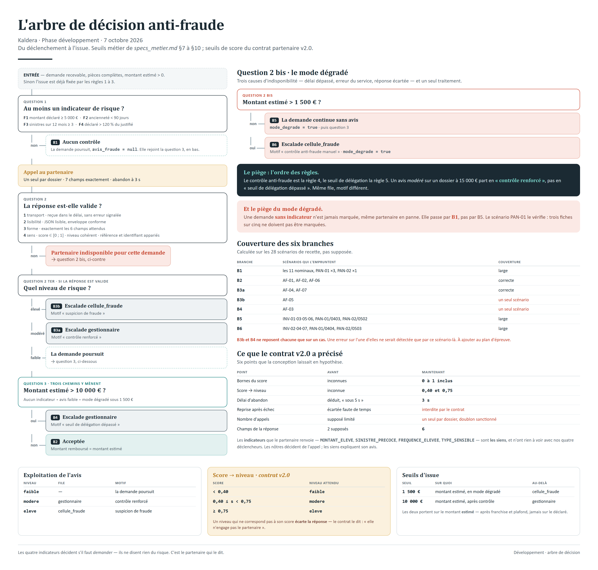

# Arbre de décision anti-fraude

Brief Kaldera · Phase DÉVELOPPEMENT · 7 octobre 2026

La logique décisionnelle complète du contrôle anti-fraude, du déclenchement à l'issue. Sert de
référence pour coder, et de grille pour tester. Les seuils viennent de `specs_metier.md` §7 à §10 ;
ceux du score viennent du contrat partenaire version 2.0.



---

## En bref

- **Six branches**, et six seulement. Toutes aboutissent à une issue : aucune ne laisse une demande
  en suspens.
- **Toutes sont couvertes** par au moins un scénario de recette — mais deux ne le sont que par un
  seul, et c'est une fragilité.
- **Le déclenchement n'est pas l'avis.** Les quatre indicateurs décident s'il faut consulter ; ils
  ne disent rien du risque. C'est le partenaire qui le dit.
- **Le piège principal** : l'ordre des règles. Le contrôle anti-fraude s'applique **avant** le seuil
  de délégation. Un avis modéré sur un dossier à 15 000 € part en « contrôle renforcé », pas en
  « seuil de délégation dépassé ».

---

## L'arbre

```
ENTRÉE — la demande est recevable, les pièces sont complètes, le montant estimé est > 0
         (sinon l'issue est déjà fixée par les règles 1 à 3)
   │
   ▼
┌─ Q1 · Au moins un indicateur de risque est-il présent ?
│   F1 · montant déclaré ≥ 5 000 €
│   F2 · ancienneté du contrat < 90 jours
│   F3 · sinistres sur 12 mois ≥ 3
│   F4 · montant déclaré > 120 % du montant justifié
│
├── NON ──────────────────────────────────────────────────► Q4 (aucun contrôle, avis_fraude = null)
│
└── OUI
     │
     ▼
   APPEL AU PARTENAIRE — un seul par dossier, 7 champs, abandon à 3 s
     │
     ▼
┌─ Q2 · La réponse est-elle valide aux quatre niveaux ?
│   1 transport  · reçue dans le délai, sans erreur signalée (HTTP 401 / 503)
│   2 lisibilité · JSON lisible, enveloppe JSON-RPC conforme
│   3 forme      · exactement les 6 champs attendus, bons types
│   4 sens       · score ∈ [0 ; 1] · niveau cohérent avec le score · référence identique · id identique
│
├── NON ──► PARTENAIRE INDISPONIBLE POUR CETTE DEMANDE
│            │
│            ▼
│          ┌─ Q3 · Montant estimé > 1 500 € ?
│          │
│          ├── NON ──► ⬛ B5 · la demande continue sans avis, mode_degrade = true ──► Q4
│          │
│          └── OUI ──► ⬛ B6 · ESCALADE cellule_fraude · mode_degrade = true
│                           motif « contrôle anti-fraude manuel »
│
└── OUI
     │
     ▼
   Q4bis · Quel niveau de risque ?
     │
     ├── eleve  ──► ⬛ B3b · ESCALADE cellule_fraude · motif « suspicion de fraude »
     │
     ├── modere ──► ⬛ B3a · ESCALADE gestionnaire · motif « contrôle renforcé »
     │
     └── faible ──► la demande poursuit
                      │
                      ▼
                    Q4 · Montant estimé > 10 000 € ?
                      │
                      ├── OUI ──► ⬛ B4 · ESCALADE gestionnaire
                      │                  motif « seuil de délégation dépassé »
                      │
                      └── NON ──► ⬛ B2 · ACCEPTÉE
                                         montant remboursé = montant estimé
```

**Q4 est partagée.** Trois chemins y mènent : aucun indicateur, avis faible, et mode dégradé sous
1 500 €. C'est la règle 5 des spécifications, et elle s'applique à toute demande qui a survécu au
contrôle.

---

## Les règles chiffrées

### Déclenchement — au moins un suffit

| Indicateur | Condition                                     | Attention                                                       |
| ---------- | --------------------------------------------- | --------------------------------------------------------------- |
| **F1**     | montant déclaré **≥** 5 000 €                 | *au moins*, pas *plus de*                                       |
| **F2**     | ancienneté du contrat **<** 90 jours          | jours entre souscription et survenance                          |
| **F3**     | sinistres sur 12 mois **≥** 3                 | *au moins*                                                      |
| **F4**     | montant déclaré **>** 1,20 × montant justifié | *plus de*. Sans facture lisible, l'indicateur ne se calcule pas |

### Exploitation de l'avis

| Niveau   | Conséquence         | File             | Motif               |
| -------- | ------------------- | ---------------- | ------------------- |
| `faible` | la demande poursuit | —                | —                   |
| `modere` | escalade            | `gestionnaire`   | contrôle renforcé   |
| `eleve`  | escalade            | `cellule_fraude` | suspicion de fraude |

### Correspondance score / niveau — *du contrat partenaire v2.0*

| Score               | Niveau attendu |
| ------------------- | -------------- |
| < 0,40              | `faible`       |
| 0,40 ≤ score < 0,75 | `modere`       |
| ≥ 0,75              | `eleve`        |

Si le niveau annoncé ne correspond pas à son score, **la réponse est écartée** — le contrat le dit
lui-même : « elle n'engage pas le partenaire ». C'est le quatrième niveau de validation.

### Seuils d'issue

| Seuil        | Sur quoi                            | Conséquence                |
| ------------ | ----------------------------------- | -------------------------- |
| **1 500 €**  | montant **estimé**, en mode dégradé | au-delà : `cellule_fraude` |
| **10 000 €** | montant **estimé**, après contrôle  | au-delà : `gestionnaire`   |

---

## Les six branches, et ce qui les couvre

Calculé sur les 28 scénarios de recette, pas supposé.

| Branche | Issue                                 | Scénarios qui l'empruntent                                           | Couverture           |
| ------- | ------------------------------------- | -------------------------------------------------------------------- | -------------------- |
| **B1**  | Aucun indicateur, pas de contrôle     | les 11 nominaux, `PAN-01` ×3, `PAN-02` ×1                            | large                |
| **B2**  | Avis faible → acceptée                | `AF-01`, `AF-02`, `AF-06`                                            | correcte             |
| **B3a** | Avis modéré → gestionnaire            | `AF-04`, `AF-07`                                                     | correcte             |
| **B3b** | Avis élevé → cellule_fraude           | `AF-05`                                                              | **un seul scénario** |
| **B4**  | Avis faible, puis seuil de délégation | `AF-03`                                                              | **un seul scénario** |
| **B5**  | Dégradé, ≤ 1 500 €, continue          | `INV-01`, `INV-03`, `INV-05`, `INV-06`, `PAN-01`/0403, `PAN-02`/0502 | large                |
| **B6**  | Dégradé, > 1 500 €, cellule_fraude    | `INV-02`, `INV-04`, `INV-07`, `PAN-01`/0404, `PAN-02`/0503           | large                |

**Les deux branches à un seul scénario sont une fragilité.** B3b et B4 ne reposent chacune que sur
un cas : une erreur sur l'une d'elles ne serait détectée que par ce scénario-là. À ajouter au plan
d'épreuve.

---

## Les pièges

**1 · L'ordre des règles.** Le contrôle anti-fraude est la règle 4, le seuil de délégation la
règle 5. Une demande à avis modéré et 15 000 € d'estimé part en `gestionnaire` avec le motif
« contrôle renforcé », pas « seuil de délégation dépassé ». Les deux donnent la même file : seul le
motif les distingue.

**2 · Le déclenchement n'est pas un jugement.** Les quatre indicateurs disent « il faut demander »,
jamais « c'est suspect ». Confondre les deux reviendrait à émettre un avis en interne, ce que la
spécification interdit.

**3 · F4 a besoin de l'estimation.** Il compare le montant déclaré au montant justifié par les
factures. Sans facture lisible, le montant justifié est nul et l'indicateur ne se calcule pas —
mais la demande n'arrive alors pas jusqu'ici, puisque son montant estimé serait nul.

**4 · Le mode dégradé ne se marque que sur les demandes concernées.** Une demande sans indicateur
de risque n'est **jamais** marquée, même partenaire en panne. C'est la branche B1, et `PAN-01` la
vérifie trois fois sur cinq.

**5 · Une réponse écartée n'est pas une absence de réponse.** Les deux mènent au même endroit —
l'indisponibilité — mais pour la première, **rien du contenu reçu ne doit ressortir**, pas même
dans le motif.

**6 · Un seul appel par dossier.** Le contrat v2.0 refuse tout doublon (`-32029`) et le **signale
comme un manquement**. Aucune branche de cet arbre ne repasse par l'appel : vérifier que le code
non plus.

---

## Ce que le contrat v2.0 a précisé

| Point                         | Avant                    | Maintenant                                                 |
| ----------------------------- | ------------------------ | ---------------------------------------------------------- |
| Bornes du score               | inconnues                | **0 à 1 inclus**                                           |
| Correspondance score / niveau | inconnue                 | **0,40 et 0,75**                                           |
| Délai d'abandon               | déduit, « sous 5 s »     | **3 s**, fixé par le contrat                               |
| Reprise après échec           | interdite faute de temps | **interdite par le contrat**, dans les trois cas           |
| Nombre d'appels               | supposé limité           | **un seul par dossier**, doublon sanctionné                |
| Champs de la réponse          | 2 supposés               | **6** : + `indicateurs`, `evaluation_id`, `version_modele` |

Les `indicateurs` renvoyés par le partenaire — `MONTANT_ELEVE`, `SINISTRE_PRECOCE`,
`FREQUENCE_ELEVEE`, `TYPE_SENSIBLE` — sont **les siens**, et n'ont rien à voir avec nos quatre
déclencheurs. Ne pas les confondre : les nôtres décident de l'appel, les siens expliquent son avis.

---

## Pour tester

- [ ] Une demande par indicateur, seul, pour vérifier que chacun déclenche
- [ ] Une demande sans aucun indicateur, partenaire en panne : **ne doit pas être marquée**
- [ ] Les trois niveaux d'avis, chacun vers sa file et son motif
- [ ] Avis modéré **et** montant > 10 000 € : vérifier que c'est bien « contrôle renforcé » qui
      l'emporte
- [ ] Les quatre frontières du score : 0 · 0,399 / 0,40 · 0,749 / 0,75 · 1
- [ ] Un niveau incohérent avec son score : réponse écartée, aucune valeur retenue
- [ ] Le seuil de 1 500 € en mode dégradé : 1 500 exactement, puis 1 500,01
- [ ] Le seuil de 10 000 € : 10 000 exactement, puis 10 000,01
- [ ] Un second appel sur le même dossier : ne doit jamais se produire
