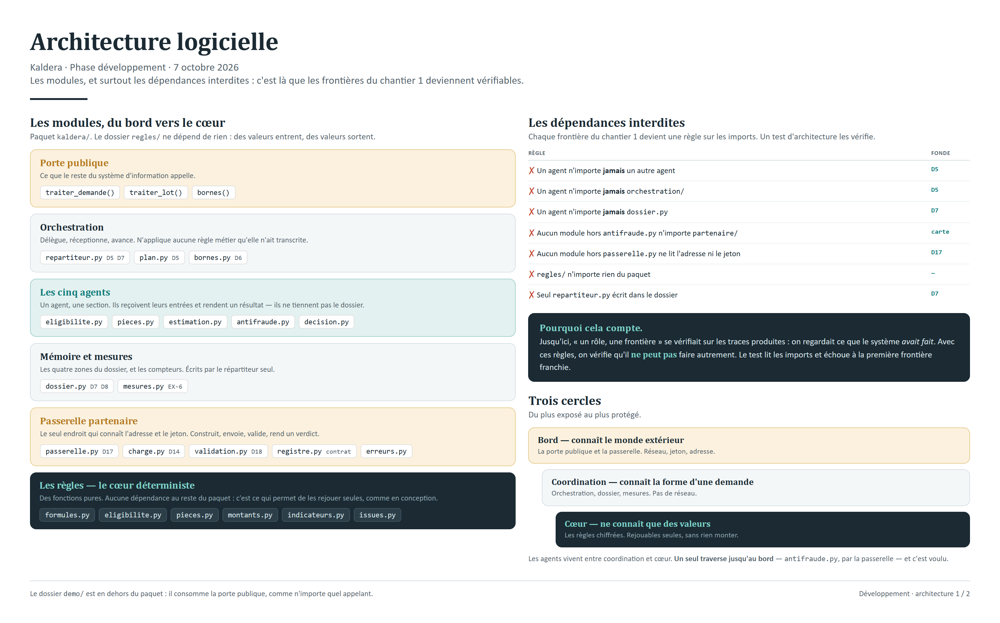
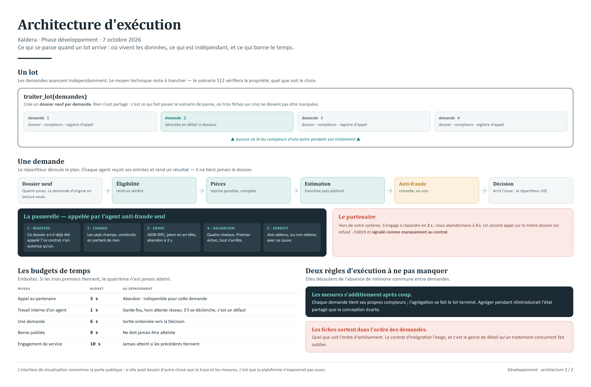

# Architecture logicielle et d'exécution

Brief Kaldera · Phase DÉVELOPPEMENT · 7 octobre 2026

Traduction de la conception en code : les modules, leurs dépendances, et ce qui se passe à
l'exécution. **Proposition devenue réalité** : les quatre points signalés **⚠** sont tranchés, et le
code vit sous `src/kaldera/`.





---

## En bref

- **Six couches**, de la porte publique aux règles chiffrées. Chaque frontière du chantier 1
  devient une **règle de dépendance** entre modules.
- **Ces règles sont testables.** Un test d'architecture lit les imports et vérifie qu'aucune
  frontière n'est franchie — c'est `EX-2` rendu automatique.
- **Les règles métier sont des fonctions pures**, sans dépendance. C'est ce qui permet de les
  rejouer isolément, comme nous l'avons fait en conception.
- **Un registre d'appels par référence** garantit la clause du contrat : un seul appel par dossier.
- **Les mesures d'un lot s'agrègent après coup**, jamais pendant — sinon on réintroduit l'état
  partagé que `D8` écarte.

---

## 1 · Les modules

```
kaldera/
├── __init__.py              porte publique : traiter_demande · traiter_lot · bornes
│
├── orchestration/
│   ├── repartiteur.py       déléguer → réceptionner → avancer          D5 D7
│   ├── plan.py              le plan conditionnel, transcrit de §10     D5
│   └── bornes.py            valeurs publiées et détection d'atteinte   D6
│
├── agents/
│   ├── eligibilite.py       → section « eligibilite »
│   ├── pieces.py            → section « pieces »
│   ├── estimation.py        → section « estimation »
│   ├── antifraude.py        → section « avis_fraude », ou rien
│   └── decision.py          → section « issue »                        D1
│
├── regles/
│   ├── formules.py          garanties, franchises, plafonds
│   ├── eligibilite.py       E1 à E5
│   ├── pieces.py            pièces exigées par type de sinistre
│   ├── montants.py          justifié · retenu · estimé (franchise puis plafond)   C3
│   ├── indicateurs.py       F1 à F4
│   └── issues.py            ordre des règles §10, seuils 1 500 et 10 000
│
├── dossier.py               les quatre zones de la mémoire partagée    D7 D8
│
├── partenaire/
│   ├── passerelle.py        seul point qui connaît l'adresse           D17
│   ├── charge.py            construction des 7 champs, en partant de rien   D14
│   ├── validation.py        les quatre niveaux                         D18
│   ├── registre.py          un seul appel par dossier        ← contrat v2.0
│   └── erreurs.py           causes normalisées
│
└── mesures.py               quatre mesures par agent + quatre signaux  EX-6
```

**Le dossier `regles/` est le cœur déterministe.** Il ne dépend de rien, ne connaît ni agent ni
dossier : ce sont des fonctions qui prennent des valeurs et en rendent. C'est ce qui a permis de
rejouer les 33 demandes en conception sans écrire une ligne du système, et ce qui le permettra
encore.

---

## 2 · Les règles de dépendance

C'est le cœur de cette architecture. Chaque frontière du chantier 1 devient une règle vérifiable
sur les imports.

| Règle                                                     | Fondement        | Ce qu'elle empêche                                |
| --------------------------------------------------------- | ---------------- | ------------------------------------------------- |
| Aucun agent n'importe un autre agent                      | `D5`             | Qu'un agent renvoie le travail à un autre         |
| Aucun agent n'importe `orchestration/`                    | `D5`             | Qu'un agent décide du chemin                      |
| Seul `agents/antifraude.py` importe `partenaire/`         | carte des agents | Qu'un autre agent parle à l'extérieur             |
| Seul `partenaire/passerelle.py` lit l'adresse et le jeton | `D17`            | Un filtre dispersé, donc invérifiable             |
| Aucun agent n'importe `dossier.py`                        | `D7`             | Qu'un agent tienne le dossier et puisse l'écraser |
| `regles/` n'importe rien du paquet                        | —                | Que le cœur métier dépende de l'orchestration     |
| Seul `orchestration/repartiteur.py` écrit dans le dossier | `D7`             | Qu'un auteur devienne scribe                      |

**Un test d'architecture les vérifie**, en lisant l'arbre syntaxique des modules. Il tourne avec les
autres tests et échoue à la première frontière franchie. C'est la façon la plus directe de rendre
`EX-2` automatique : on ne vérifie plus seulement les traces produites, on vérifie que le code **ne
peut pas** produire autre chose.

---

## 3 · Les frontières, vues autrement

Trois cercles concentriques, du plus extérieur au plus intérieur :

| Cercle           | Contient                                     | Connaît le monde extérieur ?                  |
| ---------------- | -------------------------------------------- | --------------------------------------------- |
| **Bord**         | `__init__.py`, `partenaire/passerelle.py`    | Oui : la porte publique et le réseau          |
| **Coordination** | `orchestration/`, `dossier.py`, `mesures.py` | Non, mais connaît la structure de la demande  |
| **Cœur**         | `regles/`                                    | Non. Des valeurs entrent, des valeurs sortent |

Les agents vivent entre coordination et cœur : ils appellent les règles, et ne connaissent ni le
dossier ni le réseau. L'agent `antifraude` est la seule exception — il traverse jusqu'au bord, par
la passerelle, et c'est voulu.

---

## 4 · L'exécution

### Une demande

1. La porte publique crée un **dossier neuf** — rien n'est partagé avec une autre demande.
2. Le répartiteur déroule le plan : il confie une étape, reçoit un résultat, le dépose, avance.
3. Chaque agent reçoit **ses entrées**, pas le dossier. Il rend un résultat et un verdict.
4. Quand `antifraude` doit consulter, la passerelle vérifie le **registre d'appels**, construit la
   charge, envoie, valide, rend un verdict.
5. L'agent `decision` écrit l'issue. Le répartiteur constate et clôt.
6. Si une borne est atteinte, le répartiteur confie une **dernière** main à `decision` : sortie
   ordonnée, jamais d'erreur.

### Un lot

- **Les demandes avancent indépendamment**, et le traitement reste **séquentiel** *(`D27`)*.
  Le scénario `S12` vérifie la propriété sur le lot entier : avec l'abandon à 3 s, trois
  demandes face à un partenaire lent à 5 s tiennent largement sous l'engagement de service.
- Chaque demande tient **ses propres compteurs**.
- Les mesures sont **additionnées après coup**, le lot terminé. Aucune demande ne lit les compteurs
  d'une autre pendant son traitement.
- Les fiches sont rendues **dans l'ordre des demandes**, quel que soit l'ordre d'achèvement.

### Les budgets de temps

| Niveau                     | Budget                                  | Ce qui se passe au dépassement                                     |
| -------------------------- | --------------------------------------- | ------------------------------------------------------------------ |
| Appel au partenaire        | **3 s**                                 | Abandon, partenaire déclaré indisponible pour cette demande        |
| Travail interne d'un agent | **1 s**                                 | Garde-fou, hors attente réseau. S'il se déclenche, c'est un défaut |
| Une demande                | sortie à **6 s**, borne publiée **8 s** | Sortie ordonnée vers `decision`                                    |
| Engagement de service      | **10 s**                                | Jamais atteint si les précédents tiennent                          |

---

## 5 · Ce qui était à trancher — **tout est tranché**

|        | Point                                          | Impact                                                                                                               |
| ------ | ---------------------------------------------- | -------------------------------------------------------------------------------------------------------------------- |
| **✓1** | **Séquentiel** *(`D27`)*                       | `S12` borne le lot entier : trois demandes face à un partenaire lent tiennent grâce à l'abandon à 3 s                |
| **✓2** | **Validation écrite à la main** *(`D28`)*      | Une bibliothèque accepte les champs en trop par défaut ; ce rejet ne doit pas dépendre d'une option à ne pas oublier |
| **✓3** | **Adresse configurée** *(`D29`)*               | La carte d'agent est servie, mais rien ne l'impose et elle ajouterait un appel réseau avant chaque consultation      |
| **✓4** | Emplacement du code — **tranché** le 7 octobre | Dépôt cloné à côté de la conception ; les documents restent hors du dépôt git                                        |

---

## 6 · Ce que l'interface de visualisation ajoute

Elle ne fait pas partie du paquet `kaldera` : elle le **consomme**. Un dossier séparé, qui appelle
la porte publique et met en forme ce qu'elle rend.

```
demo/
├── rejouer.py       appelle traiter_demande / traiter_lot, exporte en JSON
├── page.html        les quatre vues : flux · dossier · échange A2A · lot et mesures
└── static/          la palette et les styles des schémas de conception
```

Cette séparation compte : **si la démo avait besoin d'autre chose que la trace et les mesures, ce
serait le signe que la plateforme n'expose pas assez.** La contrainte est volontaire.

---

*Les décisions `D1` à `D24` sont dans les documents de conception ; le contrat partenaire v2.0 et
sa confrontation aux hypothèses sont dans [`01_confrontation_contrat.md`](01_confrontation_contrat.md).*
